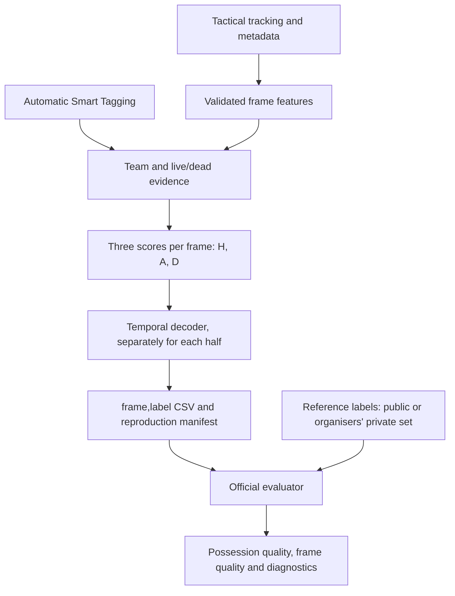

# Understanding our possession algorithm

Team learning and development guide · Updated 27 October 2026

This guide explains the algorithm at commit `b5eac8b` (unchanged by the
27 October move into `solution/code/`), the official scoring
code, and the fixed comparison originally recorded in `artifacts/head-to-head/`.
New comparison runs default to `solution/reports/head-to-head/`. It is a
longer companion to the submission-oriented [technical report](TECHNICAL_REPORT.md).
Local generated reports are ignored by Git; their aggregate findings are included
below so this explanation remains useful in a fresh clone.

Our method combines **evidence about ball control**, **evidence about whether play
is live**, and **an optimiser that chooses a consistent sequence of states**.
It consumes tracking coordinates and automatic tactical tags. It does not analyse
video pixels itself. Most of its assumptions are explicit rules and weights; one
small movement model is fitted without possession labels.

The competition rewards recovery of complete possession phases. Runtime matters
for practicality, but is not a ranking criterion in the current official scorer.
A faster program and a better possession detector are separate achievements.

Throughout this guide:

- **Implemented** describes behaviour visible in the source code.
- **Measured** describes an executed test or an existing official aggregate report.
- **Hypothesis** describes a possible explanation that has not been isolated experimentally.
- **Proposed** describes future work, not functionality already delivered.

## Reading map

1. [What counts as possession](#1-what-counts-as-possession)
2. [From input files to evaluated output](#2-from-input-files-to-evaluated-output)
3. [How the original baseline works](#3-how-the-original-baseline-works)
4. [How our algorithm builds evidence](#4-how-our-algorithm-builds-evidence)
5. [How the temporal decoder decides](#5-how-the-temporal-decoder-decides)
6. [How the official evaluator scores it](#6-how-the-official-evaluator-scores-it)
7. [What our measured results mean](#7-what-our-measured-results-mean)
8. [What is established and what remains uncertain](#8-what-is-established-and-what-remains-uncertain)
9. [A development plan supported by evidence](#9-a-development-plan-supported-by-evidence)
10. [Commands and source map](#10-commands-and-source-map)
11. [Glossary](#11-glossary)

## 1. What counts as possession

The deliverable is one label for every frame of the tactical video: 199,319 rows
at 25 frames per second. A frame is one observation every 0.04 seconds.

| Label | Meaning |
|---|---|
| `H` | Home team in possession, ball in play |
| `A` | Away team in possession, ball in play |
| `D` | Dead ball: play has stopped |
| `X` | Our system abstains, or the reference has no label for that frame |

A possession changes when the other team gains **controlled possession**. A
deflection, a brief touch or winning an aerial duel without subsequent control
does not necessarily change possession. During a loose or contested ball, the
last possessing team retains possession until the other team gains control.

The challenge mentions sustained control or consecutive passes as possible
proxies. It does not mandate a particular number of seconds or passes. Our method
does not count completed passes.

A possession phase, called a **spell** in the scorer, is a maximal uninterrupted
run of `H` or `A`. For example, these are invented label sequences:

```text
H H H A A       -> two possession phases
H H D D H H     -> two possession phases, separated by a stoppage
H H H H H      -> one possession phase
```

`D` is not itself a possession. Missing a stoppage can merge two real possessions
of the same team, even if we never assign the ball to the wrong team.

The reference labels come from corrected tracking: dead-ball status supplies
`D`; otherwise the owning team supplies `H` or `A`. They are not subsequently
smoothed. Our physical intuition is useful for building a model, but it does not
replace that reference definition.

Sources: [possession rules](../docs/CHALLENGE.md#possession-rules),
[`possession_spells`](../evaluation/possession_metrics.py#L464).

## 2. From input files to evaluated output



Reference labels enter **evaluation only**. Inference does not read them.

The current inputs are:

| Input | What we use it for |
|---|---|
| Tactical ATD metadata XML | Associate track slots with teams |
| Tactical ATD text | Player positions/speeds and ball observations per frame |
| Tactical Smart Tagging XML | Soft tactical and restart evidence |
| `games.py` | Frame count, frame rate, pitch dimensions and published half boundaries |

The videos, broadcast tracking and homography are not used by this implementation.
Broadcast has its own unsynchronised timeline; it cannot simply be concatenated
with tactical frames. Tactical coordinates are already expressed relative to the pitch.

Tracking slots are not stable player identities. There are 46 tactical slots for
22 players, and slots can disappear, duplicate people or change identity. We use
their team membership and collective information rather than assuming that
"Track 12" is the same person throughout the game.

The supplied ball track is absent on about 41% of the officially graded full-match
frames, according to [DATA.md](../docs/DATA.md). Missingness is therefore a core part of
the problem, not an exceptional input error.

## 3. How the original baseline works

The comparison uses the preselected published reference, `baseline_smooth50`.
It has two steps:

1. For each frame with usable observations, find the player nearest the ball and
   assign that player's team. Without an answer, record an unknown internal code.
2. Look at a centred window of **50 frames before and 50 after**, plus the current
   frame. Choose whichever team occurs more often in that window.

The full window is 101 frames, roughly four seconds, not 50 frames in total.
The code counts only home and away observations in this vote. It emits `D` when
neither team has an observation anywhere in the window. Ties favour `H`.
Consequently, an individual missing-ball frame need not become `D` after smoothing.

This baseline is inexpensive and suppresses many brief label changes. However,
its geometry does not distinguish a controlled reception from a ball merely
passing near a player. It also has no direct model of stoppages or restarts, and
the same smoothing window affects both noisy touches and genuine short phases.

Both the baseline and our method use future observations. This baseline's
centred vote is already an offline operation.

Source: [`nearest_player_labels` and `smooth`](../starter/baseline.py#L109).

## 4. How our algorithm builds evidence

### 4.1 Read, align and validate the observations

[`read_tracking`](code/possession/data.py#L99) streams the ATD in blocks of up to 4,096
lines. This is a memory and parsing optimisation; changing the block size must not
change the features or predictions.

The loader checks numeric fields, frame count and consecutive frame IDs. ATD
frames start at 1, while output CSV frames start at 0. Tactical tagging timestamps
are converted with `round(seconds * 25)`. Correct alignment is essential: a good
decision attached to the wrong frame can become a wrong phase boundary.

Coordinates are normalised. Distances are calculated after scaling the axes by
the pitch dimensions in `games.py`: 105.3 by 68.0 metres. Treating the normalised
pitch as a square would distort nearest-player distances.

For each frame, the loader retains compact features rather than full trajectories:

| Feature | Currently used by inference? |
|---|---|
| Ball x/y position | Yes |
| Minimum ball distance to each team | Yes |
| Mean valid player speed | Yes |
| Speed of the closest player on each team | Extracted, currently unused |
| Fraction of valid player speeds above 2 m/s | Extracted, currently unused |
| Visible player count | Extracted, currently unused |

The third ball field is supplied speed, not ball height. The model currently
recomputes ball speed from positions instead of using that field.

### 4.2 Handle short gaps and estimate movement

Within each half, implausible or missing ball positions are treated as unavailable.
Gaps of at most eight frames, or 0.32 seconds, are linearly interpolated **only if
both endpoints are observed**. Longer gaps and unbounded gaps remain missing.

This interpolation supports movement features. It does not rebuild the
ball-to-player distances for missing frames: those were computed by the loader
from original observations. A short interpolated ball path therefore does not
create a new observation of who controls the ball.

Ball speed is estimated from positions on either side of a frame. Values above
45 m/s are discarded as unreliable. Several movement signals are averaged in
centred windows, mostly around one second. All such windows stay within a half.

Sources: [`fill_short_gaps`](code/possession/model.py#L46),
[`emissions`](code/possession/model.py#L164).

### 4.3 Estimate which team is geometrically favoured

Let `dH` and `dA` be the closest home-player and away-player distances to the ball.
The initial geometric signal is:

```text
geometry = clip((dA - dH) / 2.5, -2.5, 2.5)
           * exp(-min(dH, dA) / 6.0)
```

A positive value supports `H`; a negative one supports `A`.

The distance difference identifies the nearer team. The exponential term makes
the evidence weaker when everyone is far from the ball. The 6 m parameter is a
decay scale, not a hard boundary inside which possession is guaranteed.

For an invented example, `dH = 1 m` and `dA = 5 m` produce about `+1.35` before
the speed adjustment. This is a relative score, not a 135% probability.

At ball speeds above 10 m/s, the model progressively reduces this signal, reaching
30% of its original strength at 25 m/s and above, where speed remains usable.
The intention is to avoid handing possession to somebody just because a fast ball
passes nearby. Both team distances must be available; otherwise geometry is neutral.

**Limitation:** proximity and speed do not establish contact or control. Ball
height, a player's body orientation and actual foot/head contact are not observed.

Source: [`emissions`, geometry calculation](code/possession/model.py#L193).

### 4.4 Add automatic tactical evidence

Smart Tagging contains intervals such as build-up, progression, attacking
transition, defensive transition and set pieces. These are automatic estimates,
not correct possession labels supplied to us.

For an attacking tag, its named team receives support. For a defending tag, the
opposing team receives support. Unknown team names supply no team assignment.

The implementation weakens the edges of ordinary phase tags over roughly half
a second. Some transition tags receive stronger support. Overlapping tags for
the same side are combined using their maximum, rather than adding every one:
several correlated descriptions should not count as independent observations.

The team signal combines geometry with the difference in tag support:

```text
team_score = geometry + 1.25 * (home_tag_support - away_tag_support)
```

Tags can bridge ball occlusions. Incorrect long tags can also favour an incorrect
team for many consecutive frames. The multiplier 1.25 is a fixed modelling
assumption, not a value established as optimal by the public evaluation.

Source: [`tagging_evidence`](code/possession/model.py#L113).

### 4.5 Estimate whether the ball is in play

The model fits two movement regimes to the logarithm of mean player speed using
an unsupervised two-component Gaussian mixture. EM repeatedly estimates which
regime observations resemble and updates their means, variances and weights.
Initialisation and stopping are deterministic.

This fit uses observations from both published halves together. The faster
regime supplies positive activity evidence; the slower regime supplies negative
activity evidence. Neither component is a learned live/dead class. Players may
stand during live play and continue moving after a whistle.
The evidence compares the regimes' weighted log densities. Because their
variances can differ, it is not simply a monotonic speed threshold.

The activity evidence is combined with other signals:

```text
alive_score = 0.4
              + 0.7 * activity_evidence
              + 1.8 * ball_movement
              - 0.4 * missing_ball_fraction
              - 1.2 * stationary_ball * slow_players
              - 3.0 * ball_outside_pitch
              + tactical_status_evidence
```

These terms are scaled signals, not raw speeds multiplied by the displayed
weights. Activity evidence is clipped to `[-4, 4]`; ball movement, missing-ball
fraction, stationary-ball and slow-player signals range from 0 to 1. The final
alive score is clipped to `[-7, 7]` before conversion to state scores.

| Signal | Intended effect |
|---|---|
| Faster collective movement | Support live play |
| Ball movement | Support live play |
| Missing ball | Weak evidence against live play, not an automatic stoppage |
| Stationary ball together with slow players | Support `D` |
| Observed ball outside pitch tolerances | Support `D` |
| Tactical phases and inferred restart timing | Additional live/dead evidence |

Within an automatic set-piece interval, the model searches for ball movement
onset. If unavailable, it looks for increased collective movement. If neither
is clear, it uses a weak prior around the interval midpoint. Frames before the
estimated restart receive dead-ball support; frames after it receive live and,
where possible, team support. The entire tagged interval is not labelled `D`.

The physical thresholds, weights and fallback are assumptions. A stationary
goalkeeper holding the ball, a slow live build-up, or running players after a
stoppage are plausible failure scenarios. These examples are not claims about
specific frames in the supplied match.

Sources: [`activity_evidence`](code/possession/model.py#L60),
[`tagging_evidence`](code/possession/model.py#L113),
[`alive_score` implementation](code/possession/model.py#L207).

### 4.6 Convert evidence to three scores

For each frame, the model needs one score for each possible state. With `a` as
the alive score and `g` as the team score, the implemented calculation is:

```text
sigmoid(x) = 1 / (1 + exp(-x))

score(H) = log(sigmoid(a))  + min(g, 0)
score(A) = log(sigmoid(a))  - max(g, 0)
score(D) = log(sigmoid(-a))
```

The favoured live team receives the full live score; the other team gets a
penalty. With no team evidence, `H` and `A` have equal frame scores. Missing team
evidence therefore does not by itself favour `D`.

These values are **unnormalised scores, not calibrated three-class probabilities**.
They support comparisons and temporal optimisation. They cannot be reported as
"70% confidence that H owns the ball". Normalising them would not establish
empirical calibration either.

Source: [`emissions`, final scores](code/possession/model.py#L210).

## 5. How the temporal decoder decides

### 5.1 Choose the best complete sequence

Choosing the highest-scoring label independently in every frame would flicker
whenever geometry or tags briefly disagree. The Viterbi decoder instead maximises:

```text
total sequence score
    = sum of chosen frame scores
      - sum of costs for changing state
```

For every frame and possible state, dynamic programming retains the best score
of a path ending there and enough predecessor information to reconstruct it.
A backward pass returns the best complete sequence. It does not enumerate every
possible sequence, which would be computationally infeasible for a full match.

The implementation finds the optimum of **this specified objective**, not the
optimum of spellF1 or a guaranteed correct football interpretation.

| Parameter | Current value | Meaning |
|---|---:|---|
| `team_switch_cost` | 20 | Penalty for `H` to `A` or `A` to `H` |
| `stoppage_switch_cost` | 24 | Penalty for entering or leaving `D` |
| `min_state_s` | 0.32 s | Minimum duration of an internal state run: eight frames |

Each label has age substates. A new run must progress through eight frames before
it may be left. The first and last run at a half boundary can be shorter, because
we do not observe the surrounding part of that run.

Half boundaries reset decoding. Outside the published halves the output is `X`.
Inside them the current model always selects `H`, `A` or `D`; it does not abstain.

Sources: [`Config`](code/possession/model.py#L16), [`decode`](code/possession/model.py#L219),
[`predict`](code/possession/model.py#L283).

### 5.2 Why this can suppress both false touches and true short phases

Consider an invented `H -> A -> H` excursion surrounded by clear home possession.
The two team changes cost `20 + 20 = 40`. If the away alternative gains only 2
score units per frame, it must accumulate enough evidence to pay for both changes.

Executed synthetic examples with the current decoder:

| Away-favoured interval | Total advantage | Two-switch cost | Selected away frames |
|---|---:|---:|---:|
| 10 frames / 0.4 s | 20 | 40 | 0 |
| 30 frames / 1.2 s | 60 | 40 | 30 |

Both intervals exceed the minimum eight frames. The first disappears because
of the score tradeoff, not because it violates the minimum duration.
The result depends on surrounding scores and boundaries; this is not a universal
1.2-second possession threshold. Stronger evidence can justify a shorter run.

This mechanism protects against deflections and noise. It can also erase a real
short possession whose evidence is weak. Reducing all penalties may restore that
phase while also restoring many false changes. This tradeoff needs independent
validation, not a target possession count taken from the competition reference.

### 5.3 Offline analysis and runtime

The method uses future observations through centred windows, two-sided
interpolation, restart analysis and the complete Viterbi path. A later observation
can affect an earlier decision. It is not a streaming live commentator.

The parser scales approximately with frames times track slots. For fixed state
and age counts, decoding scales linearly with frames. Compact predecessor storage
uses three bytes per frame, in addition to feature arrays and working storage.

`solution/code/benchmark_runtime.py` measures whole CLI calls: startup, reading, computation and
output. Our CLI additionally validates the CSV, hashes inputs/code/output and
writes a manifest. That benchmark does not isolate the decoder's cost, so it cannot
identify the main runtime bottleneck without profiling.

## 6. How the official evaluator scores it

### 6.1 Validate the CSV and select the graded frames

The evaluator checks the submission format and frame coverage. Reference frames
labelled `X` are not graded. Our own `X` predictions do not decide which frames
count: abstaining cannot remove a difficult frame from the reference mask.

The public reference covers 7,500 frames, or five minutes. The full-match CSV still
has 199,319 rows. Counts from a whole-match prediction and counts from the public
evaluation therefore describe different time spans.

### 6.2 Match complete possessions with temporal IoU

The scorer extracts maximal `H` and `A` intervals from reference and prediction.
Candidate matches must describe the **same team**. Their temporal intersection
over union is:

```text
IoU = duration of the overlap / duration of the union
```

Invented example: reference possession `[10 s, 20 s)` and prediction
`[12 s, 22 s)` overlap for 8 seconds and cover 12 seconds together. Their IoU is
`8 / 12 = 0.667`. They can match at 0.5 or 0.6, but not at 0.7.

IoU has no fixed one-second tolerance. The same boundary error has a greater
relative effect on a short possession than on a long one. An overlap threshold
of 0.5 does not merely mean "cover half the reference phase": extra predicted
duration also enlarges the denominator.

The scorer sorts candidates by descending IoU and greedily matches them one to
one. Each predicted and reference possession can participate in at most one
match. It then counts:

| Symbol | Meaning |
|---|---|
| TP | Matched possessions |
| FP | Predicted possessions without a qualifying match |
| FN | Reference possessions without a qualifying match |

An FP may reflect a wrong team or insufficient overlap, not necessarily an
entirely invented event. Equal TP counts for two algorithms do not establish
that they recovered the same reference phases.

```text
precision = TP / (TP + FP)
recall    = TP / (TP + FN)
F1        = 2 * TP / (2 * TP + FP + FN)
```

Precision asks how many predicted phases are valid matches. Recall asks how many
real phases were recovered. F1 balances both.

The official ranking score is:

```text
spellF1 = mean(F1@0.3, F1@0.4, F1@0.5, F1@0.6, F1@0.7)
```

It is an average of five F1 values, not a frame accuracy or a single-threshold F1.
Overfragmentation creates unmatched predictions; overmerging loses reference
phases and can damage IoU. Merely predicting the right total number is insufficient.

Source: [`spell_scores` and matching helpers](../evaluation/possession_metrics.py#L472).

### 6.3 Why almost perfect frame accuracy can still give poor phases

We executed this entirely synthetic example with the unchanged official scorer:

```text
Reference: 200 frames H, 100 frames A, 200 frames H
Prediction: identical, except one isolated A inserted inside each H phase
```

Only two of 500 frames are wrong: **99.6% frame accuracy**. But the two isolated
errors split the two long home possessions, producing **seven predicted phases
instead of three**. Official mean spellF1 is only **0.44**.

This explains why counting correct frames alone is inadequate. It also explains
why indiscriminate smoothing seems attractive, and why we must balance it against
preserving genuine short possessions.

### 6.4 Frame metrics, transitions and ranking order

`macroF1` computes separate F1 scores for the frame classes `H`, `A` and `D`, then
averages those three scores equally. `accuracy` is simply the fraction of graded
frames labelled correctly. These are different metrics.

The implemented ranking order is:

1. Higher mean spellF1.
2. Higher macroF1.
3. Higher transition F1 at the larger evaluated tolerance.
4. Lower mean absolute latency of matched transitions.
5. Submission name for a remaining tie.

The displayed `transF1` uses a separate matching rule for state changes. At the
default loose tolerance it accepts transitions within 25 frames, or one second.
The destination label must agree; the origin need not. Transitions include
stoppages and restarts, not only direct `H <-> A` changes.

`lat_f` is the signed prediction time minus reference time **for matched
transitions only**, in frames. Negative means early; positive means late. A small
average does not imply that all transitions were found, and opposite errors can
cancel. It should be read alongside match counts and absolute error.

The scoreboard also shows `poss` (predicted possessions), `dur` (their mean length
in seconds), `shareE` (absolute home-possession-share error) and `frag` (predicted
constant-label segment count after X filling divided by reference segment count).
Segments normally contain H/A/D, but an entirely abstained graded block remains
one X segment. These measures diagnose different behaviours; none replaces the
ranking metric. `frag` includes stoppages, so it is not simply the ratio of
possession counts.

Sources: [`rank_key`](../evaluation/run_evaluation.py#L165),
[`transition_scores`](../evaluation/possession_metrics.py#L381),
[`fragmentation`](../evaluation/possession_metrics.py#L446).

### 6.5 How X is handled

For frame metrics, an `X` on a graded frame is a miss. For temporal metrics, the
scorer forward-fills predicted `X` with the last known label inside each contiguous
graded block. Leading `X` values are back-filled from the first known label.

Thus `H X X H` can become one continuous home possession. But `H X X A` can carry
home possession too far across a real change. If an entire block is `X`, there is
no known value to copy, so it remains `X` and contains no predicted H/A possessions.
Filling and segmentation never cross reference gaps such as halftime.

Our current inference emits `X` only outside the published half boundaries.
Adding internal abstention would not automatically improve quality.

Source: [`fill_abstentions`](../evaluation/possession_metrics.py#L274).

## 7. What our measured results mean

These are the unchanged methods on the same public five-minute reference.
Both use tactical tracking; our method additionally uses automatic Smart Tagging.

| Metric | Original `baseline_smooth50` | Our method |
|---|---:|---:|
| Official mean spellF1 | 0.3256 | 0.4444 |
| F1 at IoU 0.5 | 0.3256 | 0.5185 |
| Matched possessions at IoU 0.5 | 7 | 7 |
| Missed possessions at IoU 0.5 | 10 | 10 |
| Unmatched predictions at IoU 0.5 | 19 | 3 |
| Precision at IoU 0.5 | 26.92% | 70.00% |
| Recall at IoU 0.5 | 41.18% | 41.18% |
| Predicted possessions; reference 17 | 26 | 10 |
| Mean predicted duration; reference 14.19 s | 10.80 s | 26.65 s |
| Frame macroF1 | 0.6207 | 0.7362 |
| Frame accuracy | 71.32% | 75.57% |
| Dead-ball frame F1 | 0.3225 | 0.6652 |
| Dead-ball frame recall | 21.38% | 52.21% |
| Matched state transitions within one second; reference 20 | 2 | 3 |

At IoU 0.5, the gain is **higher precision with the same number of recovered
phases**. The ten predicted possessions are not ten correctly detected possessions:
only seven qualify as matches at this threshold.

The picture also depends on the temporal tolerance:

| IoU threshold | Old matched phases | New matched phases | Old F1 | New F1 |
|---|---:|---:|---:|---:|
| 0.3 | 11 | 7 | 0.5116 | 0.5185 |
| 0.4 | 10 | 7 | 0.4651 | 0.5185 |
| 0.5 | 7 | 7 | 0.3256 | 0.5185 |
| 0.6 | 5 | 6 | 0.2326 | 0.4444 |
| 0.7 | 2 | 3 | 0.0930 | 0.2222 |

The baseline recovers more loosely aligned phases at the two lowest thresholds.
Our method produces fewer unmatched predictions and recovers one more phase at
each of the two strictest thresholds. A higher F1 does not mean higher recall at
every threshold.

Two further weaknesses are visible in the aggregate results:

- Our dead-ball recall is 52.21%: almost half the reference dead-ball **frames**
  receive another label. This is not a count of missed stoppage events.
- Only three of 20 reference state transitions match within one second.
  The reported mean latency of about -3.3 frames applies to those three matches,
  not all 20 transitions. Phase overlap can be adequate even when boundaries are
  too far away to pass the stricter transition check.

Our ten relatively long predicted phases are consistent with overmerging or
missing short phases. The aggregate figures cannot establish which mechanism
caused it: team evidence, stoppage evidence, tags and transition costs can all
affect the outcome. Do not infer that reducing one specific parameter will fix it.

The official 1,000-draw bootstrap intervals for mean spellF1 are:

| Method | 5th-95th percentile |
|---|---:|
| Baseline | 0.2140-0.4465 |
| Our method | 0.2370-0.6519 |

They overlap substantially. There are only 17 reference possessions; 7,500 highly
correlated frames are not 7,500 independent possession examples. Separate bootstrap
intervals are not a paired significance test. Private full-match superiority is
unknown. The approximately 0.04 noise band mentioned in the challenge was calibrated
on a full match and is not a significance threshold for this public window.

Also avoid comparing our public 0.4444 with the published **private full-match**
baseline score of 0.2433. Those scores cover different data. The comparable public
baseline score is 0.3256.

Sources: locally generated `solution/reports/head-to-head/possession_quality.json` and
`evaluation/reports/` within that directory; [official evaluation guidance](../docs/EVALUATION.md).

## 8. What is established and what remains uncertain

| Finding | Status | Consequence |
|---|---|---|
| The CSV is valid and reproducible | Verified in previous complete runs | The submission contract works |
| Decoder agrees with exhaustive search on small synthetic cases | Verified by existing tests | Its implemented objective is solved correctly in those tests |
| Short noise can be suppressed while a sustained switch is retained | Verified on synthetic scenarios | Temporal regularisation behaves as designed in those cases |
| The new fixed method has higher public mean spellF1 | Measured | A descriptive result for this window |
| Real control is recognised reliably across football matches | Not established | Requires independent representative evaluation |
| Too few long phases are caused specifically by excessive switch cost | Hypothesis | Cannot be concluded from counts alone |
| More features or a neural model will improve the private score | Unproven | Added complexity requires evidence |

Existing tests cover input validation, frame alignment, metre scaling, block-size
invariance, short/long gaps, tag handling, halves, synthetic stoppages, decoder
optimality and deterministic output. They do not supply representative real-match
accuracy evidence.

For example, the current long-gap test keeps possession constant across the gap.
It does not test a genuine unseen change inside that gap. The synthetic stoppage
test does not establish reliable handling of incorrect set-piece tags.

Important implementation limitations include two-dimensional geometry, unavailable
ball contact/height, fixed evidence weights, fixed switching penalties and a hard
H/A/D decision even during severe uncertainty. Extracted but unused movement and
visibility features offer possible extensions, not guaranteed improvements.

Source: [synthetic test suite](tests/test_possession.py).

## 9. A development plan supported by evidence

### 9.1 Keep the evaluation boundary explicit

The supplied public labels are permitted for checking pipeline alignment and
understanding label semantics. They must not train the model, tune parameters or
select between variants. Hand-labelling or correcting any part of this supplied
match is also prohibited. Private labels and external human-produced event data
about this same match are unavailable for development under the rules.

Labels from other games, and unsupervised or self-supervised methods, are allowed
subject to the challenge's access and documentation requirements. For independent
evaluation, split by complete games rather than neighbouring frames from the same
game. Ensure those labels implement compatible possession and dead-ball semantics.

Watching this match to understand observations is allowed. Turning an observation
into a special rule for a particular timestamp is not a general algorithmic fix.

The fixed comparison in this guide is a diagnostic of unchanged methods. It is
not permission to repeatedly select variants against the public reference.

Sources: [RULES.md](../docs/RULES.md#training-and-validation-data),
[public-window guidance](../docs/EVALUATION.md#the-public-window-is-not-a-leaderboard).

### 9.2 Prioritise observable mechanisms

| Priority | Proposed work | Why it helps investigation | Verification |
|---|---|---|---|
| 1 | Add local evidence diagnostics: geometry, tags, activity, live/dead and chosen state | Reveal which signal or penalty drives a decision | Verify plots/tables against calculations on synthetic inputs; keep match-derived traces local |
| 2 | Expand synthetic scenarios | Expose known gaps without using competition labels | Controlled short possession, change during occlusion, stationary live ball, moving players during stoppage, conflicting or incorrect restart tags |
| 3 | Establish compatible data from other permitted matches | Enable model selection and claims about generalisation | Hold out complete matches; evaluate spells, boundaries and dead-ball together |
| 4 | Improve evidence of actual control | Distinguish proximity from controlled reception | Test sustained proximity, relative motion and direction changes; handle unreliable track identities |
| 5 | Improve stoppage and restart evidence | Prevent merging possessions across missed dead-ball intervals | Combine movement distribution, observation quality and restart signals; evaluate independent examples |
| 6 | Investigate evidence-dependent switching or duration models | Preserve genuine short phases while resisting noisy touches | Compare on independent matches, including both false splits and missed phases |
| 7 | Profile and optimise implementation | Reduce measured cost without obscuring semantics | Time parser/features/decoder/output separately; require identical predictions for implementation-only changes |

An evidence diagnostic is the most useful immediate engineering addition. A
single final label does not tell us whether geometry, a long tag, missing data or
switching cost dominated. The diagnostic should expose model inputs and scores;
it should not become a tool for hand-correcting this match's labels.

For a future controlled experiment, record the hypothesis, code revision,
configuration, independent dataset and input/output hashes before evaluating.
Change one mechanism at a time. Measure phase precision and recall at every IoU,
boundary errors, dead-ball errors and runtime. An ablation can isolate the effect
of tags or activity, but use independent games for selecting the resulting model.

Do not optimise toward "exactly 17 phases", a desired average duration, or the
best score on the supplied five minutes. Matching a count can hide wrong teams,
wrong timing and completely different phases.

## 10. Commands and source map

From the repository root, with the documented environment and required assets:

```powershell
# Synthetic correctness tests; no competition labels required.
.\.venv\Scripts\python.exe -m unittest discover -s solution/tests -v

# Generate the current algorithm's predictions.
.\.venv\Scripts\python.exe -m solution.code.possession --team MesQueUnCode --output-dir solution/results

# Regenerate both fixed methods, measure runtime and evaluate their quality.
.\.venv\Scripts\python.exe -m solution.code.compare_algorithms --runs 3 --bootstrap 1000

# Re-score saved comparison predictions after verifying their recorded checksums.
.\.venv\Scripts\python.exe -m solution.code.compare_algorithms --quality-only --bootstrap 1000
```

The quality-only command needs a previous complete comparison. It does not
regenerate predictions after source changes. For a fresh comparison use the full
command. Evaluation is diagnostic, subject to the public-label restrictions above.

Outputs of the comparison include:

- `solution/reports/head-to-head/possession_quality.md`: readable phase-quality analysis.
- `solution/reports/head-to-head/possession_quality.json`: exact metrics and CSV checksums.
- `solution/reports/head-to-head/comparison.md`: combined quality/runtime comparison.
- `solution/reports/head-to-head/runtime/timings.json`: individual timings and medians.
- `solution/reports/head-to-head/evaluation/reports/`: unchanged official aggregate reports.

Default generated artifacts and restricted match data are ignored by Git. Custom
output locations may require their own exclusion. Do not publish match trajectories,
frame-level extracts or other reconstructable restricted data.
The [LLM rule in the FAQ](../docs/FAQ.md#L109) also prohibits sending competition data,
videos, confidential content or their extracts to third-party hosted/cloud LLMs.
Keep analysis of those assets local; this is a separate restriction from public
redistribution.

| Read this file | To understand |
|---|---|
| [CHALLENGE.md](../docs/CHALLENGE.md) | The football definition and expected output |
| [DATA.md](../docs/DATA.md) | Input formats, missingness and timelines |
| [possession/data.py](code/possession/data.py) | Loading, validation and compact features |
| [possession/model.py](code/possession/model.py) | Evidence, movement fitting and temporal decoding |
| [possession/__main__.py](code/possession/__main__.py) | Inference orchestration, CSV and manifest |
| [starter/baseline.py](../starter/baseline.py) | Original nearest-player and smoothing method |
| [evaluation/possession_metrics.py](../evaluation/possession_metrics.py) | Exact metric definitions |
| [evaluation/run_evaluation.py](../evaluation/run_evaluation.py) | Scoring workflow and ranking order |
| [compare_algorithms.py](code/compare_algorithms.py) | Fixed head-to-head test and reports |
| [tests/test_possession.py](tests/test_possession.py) | Existing synthetic correctness checks |
| [RULES.md](../docs/RULES.md) | Allowed data, labels and development constraints |

### Reproduce the two teaching examples

This Python snippet uses only invented scores and labels. It neither loads nor
modifies the supplied match. Run it from the repository root in the solution
environment, for example as a temporary script or in a Python console.

```python
import numpy as np

from evaluation import possession_metrics as pm
from solution.code.possession.model import decode

cost = np.full((3, 3), 24.0)
cost[0, 1] = cost[1, 0] = 20.0
np.fill_diagonal(cost, 0.0)

for duration in (10, 30):
    scores = np.tile([0.0, -3.0, -100.0], (300, 1))
    scores[100:100 + duration, 1] = 2.0
    path = decode(scores, cost, min_frames=8)
    print(f"Away-favoured frames: {duration}; selected away: {(path == 1).sum()}")

reference = np.array(list("H" * 200 + "A" * 100 + "H" * 200))
prediction = reference.copy()
prediction[[100, 400]] = "A"
result = pm.evaluate(pm.label_codes(reference), pm.label_codes(prediction), bootstrap_n=0)
print(f"Frame accuracy: {result['accuracy']:.3f}")
print(f"Mean spellF1: {result['spell_f1_mean']:.2f}")
print(f"Reference phases: {result['n_gt_spells']}; predicted: {result['n_pred_spells']}")
```

Expected output, verified with the current code:

```text
Away-favoured frames: 10; selected away: 0
Away-favoured frames: 30; selected away: 30
Frame accuracy: 0.996
Mean spellF1: 0.44
Reference phases: 3; predicted: 7
```

## 11. Glossary

| Term | Meaning in this project |
|---|---|
| Ground truth / reference | Labels used by the evaluator as the answer key |
| Feature | A measured or computed property, such as distance or mean speed |
| Evidence / emission score | A per-frame preference for one state |
| Unsupervised fitting | Estimating structure without human possession labels |
| EM | Alternating estimation of mixture memberships and distribution parameters |
| Viterbi decoding | Efficient search for the best state sequence under a specified score |
| Switching cost | A penalty for changing the inferred state |
| Spell | A maximal uninterrupted home- or away-possession interval |
| IoU | Temporal overlap divided by temporal union |
| Precision | Fraction of predictions that match a reference object |
| Recall | Fraction of reference objects recovered |
| Fragmentation | Splitting an underlying state interval into several predicted intervals |
| Overmerging | Joining distinct underlying phases into a longer prediction |
| Ablation | Removing or changing a component to investigate its contribution |
| Calibration | Checking whether stated probabilities correspond to observed frequencies |
| Generalisation | Performance on other matches beyond the data used for development |
